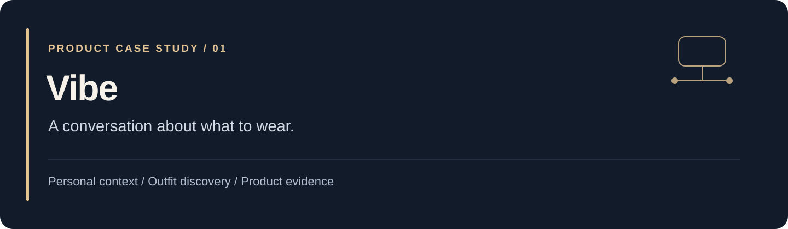
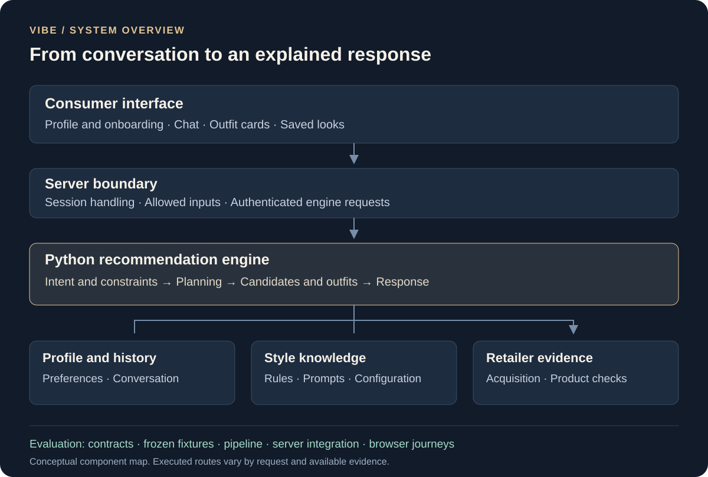

# Vibe

**Personalized fashion discovery, explained through conversation.**

Vibe is an application for exploring clothing recommendations around an occasion, personal preferences, a budget, and wardrobe context. Its engineering connects request interpretation, style knowledge, outfit composition, and evidence about retailer products.

[Read the engineering case study](https://github.com/jaychitransh007/jaychitransh007/blob/main/projects/vibe.md) · [Meet the builder](https://github.com/jaychitransh007) · [Earlier Shopify prototype](docs/SHOPIFY_PROTOTYPE.md)

## What this repository contains

This is Vibe's **public project overview**, not the application's source distribution. The standalone application's source is private and under active development. There are no installation commands for the current application in this repository.

The original page described an earlier Shopify storefront experience. That documentation is preserved as a [historical prototype snapshot](docs/SHOPIFY_PROTOTYPE.md); its routes, deployment details, discounts, and feature descriptions should not be read as the current standalone product's contract.

## The product problem

“Find something for a dinner” is only the beginning of a clothing decision. A useful recommendation needs context: the intended occasion, preferred silhouette or color, spending limits, pieces the person already owns, and the products they can actually inspect.

Vibe explores a conversational way to work through that decision, including refinements and explanations rather than only presenting a list of similar images.

## A representative experience

1. Complete the profile and onboarding requirements.
2. Describe an occasion, preferences, and a budget.
3. Inspect suggested outfits, explanations, and product details.
4. Refine the request or refer back to an outfit.
5. Explore the available saved-look, wardrobe, and visualization surfaces.

Specific query support and current retailer availability need verification against the version being demonstrated. The documented shopping scope is the United States and India.

## How it works

| Area | Engineering focus |
| --- | --- |
| Conversation | Translate requests and follow-ups into explicit intent and constraints. |
| Styling | Combine relevant profile context, style knowledge, and recommendation planning. |
| Products | Acquire and check retailer information supporting shopping suggestions. |
| Continuity | Keep references to outfits, retained pieces, and previous feedback coherent. |
| Evaluation | Distinguish code contracts, frozen fixtures, pipeline runs, and live journeys. |

The [case study](https://github.com/jaychitransh007/jaychitransh007/blob/main/projects/vibe.md) explains these choices, their tradeoffs, and the limits of the available evidence.

## Status and evidence

This overview was prepared on **23 October 2026**. It describes product direction and documented implementation structure. It does not claim a current measured accuracy, latency, commercial result, or completed user study. Generated try-on visuals are illustrations, not physical-fit guarantees.

For a product walkthrough or engineering collaboration, [start a conversation in the portfolio](https://github.com/jaychitransh007/jaychitransh007/issues/new).
