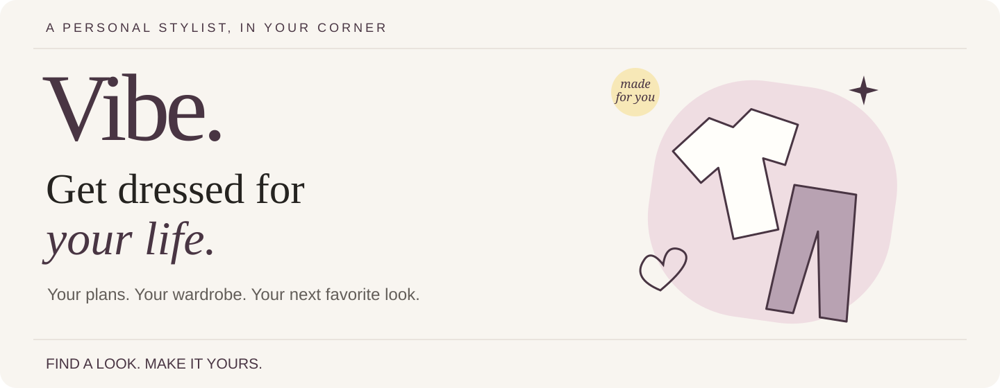
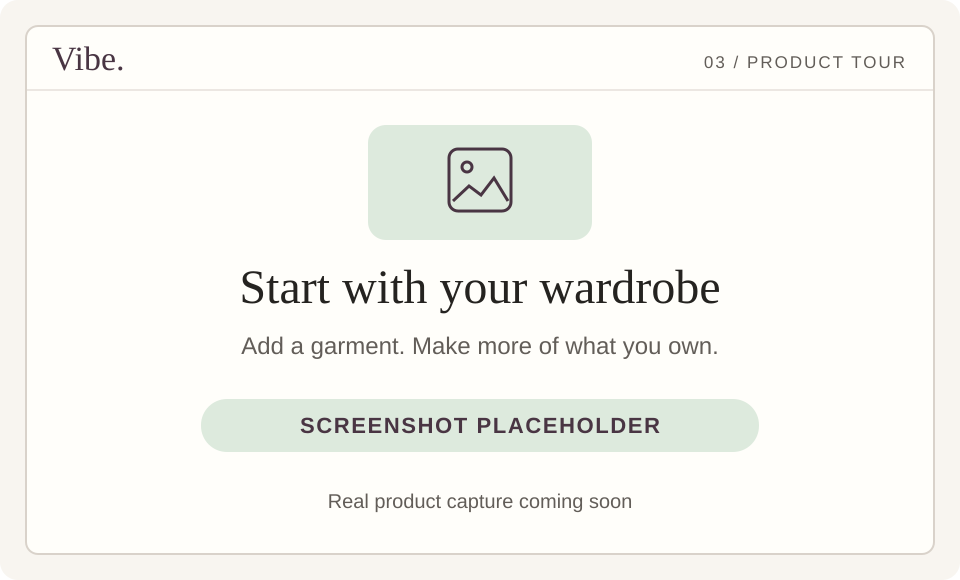
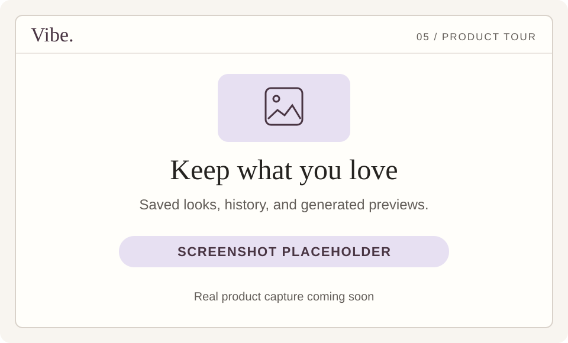

### Your plans. Your style. Your Vibe.

Tell Vibe what you’re dressing for. Explore outfit ideas, work with pieces you own, see a virtual try-on, and find the retailer details to take the next step.

 &nbsp;  &nbsp; 

[Chat](https://vibe-consumer-web.vercel.app/) · [Your looks](https://vibe-consumer-web.vercel.app/looks.html) · [Your wardrobe](https://vibe-consumer-web.vercel.app/wardrobe.html) · [Your profile](https://vibe-consumer-web.vercel.app/profile.html) · [Help](https://vibe-consumer-web.vercel.app/support.html)

**Shopping in India and the United States · Sign in with a mobile code · For adults 18+**

## See Vibe in action

**Video placeholder — recording coming soon.** In the meantime, [follow the walkthrough](docs/DEMO.md) or [open the real app](https://vibe-consumer-web.vercel.app/).

**Jump to:** [Get started](#start-your-first-vibe) · [Features](#explore-the-features) · [Screenshots](#a-look-around-vibe) · [Example prompts](#what-would-you-like-to-try) · [Questions](docs/FAQ.md) · [What’s next](docs/ROADMAP.md)

## Start your first Vibe

| Step | What to do |
| --- | --- |
| **01 · Meet Vibe** | [Open the app](https://vibe-consumer-web.vercel.app/) and sign in with the code sent to your mobile number. No invitation code is required. |
| **02 · Make it personal** | Complete your profile, measurements, headshot, and full-body photo. Let the style analysis finish before asking for recommendations. |
| **03 · Tell it your plans** | Describe the occasion, what you like, and your budget. Mention anything you want to include or avoid. |
| **04 · Make the look yours** | Browse outfit cards, inspect a piece, ask a follow-up, save a look, or use virtual try-on when available. |

Your shopping market is detected automatically: **India / INR** or **United States / USD**. Account pages use your signed-in session; complete onboarding from Chat before opening them. [Read the getting-started guide →](docs/GETTING_STARTED.md)

## What would you like to try?

Choose a starting point. Open a prompt guide, copy an example, and paste it into Vibe after onboarding.

| Dress for a plan | Make more of your wardrobe |
| --- | --- |
| **“I have a dinner coming up.”** Describe the occasion, style, and budget. [Try occasion styling →](docs/TRY_VIBE.md#dress-for-an-occasion) | **“Build around this shirt.”** Start with an owned garment. [Try wardrobe styling →](docs/TRY_VIBE.md#style-something-you-own) |
| **“Just a shirt this time.”** Ask for a particular garment instead of a whole outfit. [Try a focused request →](docs/TRY_VIBE.md#find-a-single-piece) | **“Can we change the trousers?”** Refer to a specific look and say what to keep. [Try a refinement →](docs/TRY_VIBE.md#refine-a-look) |
| **“Why does this work?”** Explore the explanation behind a recommendation. [Ask for an explanation →](docs/TRY_VIBE.md#understand-a-recommendation) | **“Help me understand smart casual.”** Ask a style question without requesting products. [Try style advice →](docs/TRY_VIBE.md#ask-for-style-advice) |

## Explore the features

Click a feature to open its guide. Each section includes a link to the relevant place in the app.

<strong>01 · Find outfits and individual pieces</strong>

Describe your occasion and preferences in your own words. Ask for a complete clothing look or a specific piece, and include a budget, color, material, or style direction. Browse the returned outfit carousel and open a garment to inspect it.

**Try:** “Find me a relaxed dinner outfit under ₹8,000. I like black and earth tones.”

[Start a styling conversation ↗](https://vibe-consumer-web.vercel.app/) · [Prompt ideas](docs/TRY_VIBE.md)

<strong>02 · Refine a look through conversation</strong>

Ask for a different direction, explain what feels too formal, or identify the garment you want to change. Name the look and say what you want to retain so your request is clear. You can also remove a look from the displayed collection and give feedback on recommendations.

**Try:** “In outfit 2, keep the shirt and change the trousers. Stay within my budget.”

[Continue in Chat ↗](https://vibe-consumer-web.vercel.app/) · [Refinement examples](docs/TRY_VIBE.md#refine-a-look)

<strong>03 · Bring your own clothes</strong>

Upload a garment photo and choose its category in **Wardrobe**. In Chat, use the attachment control to add a garment photo or choose an item from your saved wardrobe. Explain which piece you already own and what you want to pair with it.

**Try:** “I already own this linen shirt. Help me style it for a casual dinner.”

[Open your wardrobe ↗](https://vibe-consumer-web.vercel.app/wardrobe.html) · [Wardrobe guide](docs/FEATURES.md#wardrobe-and-garment-photos)

<strong>04 · See a virtual try-on</strong>

On an eligible outfit card, choose **Virtual try-on** to create an AI-generated preview using your profile photo and the available garment images. Revisit generated previews in **Looks**, including the “Virtual try-ons only” filter. A generated preview helps you visualize a direction; check real garment measurements and retailer images for fit and details.

[Open your looks ↗](https://vibe-consumer-web.vercel.app/looks.html) · [Try-on guide](docs/FEATURES.md#virtual-try-on)

<strong>05 · Understand the look and inspect the products</strong>

Explore the outfit explanation, garment descriptions, retailer names, displayed prices, and the look’s total. Product indicators explain the available evidence about the listing, returns, and shipping eligibility. Ask Vibe why a piece was recommended or how the choices relate to your request.

Use the retailer action on a product to open its own site. Purchases happen with the retailer; confirm its final price, size, stock, delivery, and return conditions there.

[Explore products in Chat ↗](https://vibe-consumer-web.vercel.app/) · [Product guide](docs/FEATURES.md#product-details-and-retailer-links)

<strong>06 · Save looks and shortlist pieces</strong>

Save an outfit you like and revisit it in **Looks history**. Filter by theme, saved looks, or virtual try-ons. On individual product details, use the wishlist action to shortlist a piece. Look saves and product wishlisting are separate actions.

[Open Looks history ↗](https://vibe-consumer-web.vercel.app/looks.html) · [Saving guide](docs/FEATURES.md#looks-history-saves-and-wishlisting)

<strong>07 · Share a generated look</strong>

After a try-on is available, use **Share look** to create a share link. Supported browsers open the device’s share sheet; otherwise Vibe can copy the link. Someone opening the link sees the shared-look page rather than your full chat history.

[Go to your looks ↗](https://vibe-consumer-web.vercel.app/looks.html) · [Sharing guide](docs/FEATURES.md#sharing)

<strong>08 · Review your personal style profile</strong>

Review the profile and style-analysis information used for personalization. Edit your details and measurements, switch the measurement preset, replace your headshot or full-body photo, and refresh the analysis after a change.

[Open your profile ↗](https://vibe-consumer-web.vercel.app/profile.html) · [Profile guide](docs/FEATURES.md#profile-and-personalization)

<strong>09 · Explore retailers and suggest a store</strong>

Open the retailer directory to see stores and their checking or indexing status. Submit a retailer you would like Vibe to consider. A submitted store goes through compatibility checks before it becomes an active source of eligible products; submission is not immediate approval.

[Explore or add a retailer ↗](https://vibe-consumer-web.vercel.app/retailers.html) · [Retailer guide](docs/FEATURES.md#retailer-directory)

<strong>10 · Shape what Vibe builds next</strong>

Browse the feature-request board, sort by most upvoted or newest, submit a specific idea, and vote for requests you would use. Requests and votes are connected to signed-in accounts; other members do not see your phone number.

[Open the feature board ↗](https://vibe-consumer-web.vercel.app/feature-requests.html) · [See the current roadmap](docs/ROADMAP.md)

<strong>11 · Manage your account and get help</strong>

Use the profile menu for help, privacy information, and the available data controls. You can obtain a copy of your data, withdraw styling consent, sign out, or use **Delete my Vibe data** when you choose to remove your account data. For a broken retailer link or account problem, use the support page.

[Support ↗](https://vibe-consumer-web.vercel.app/support.html) · [Privacy ↗](https://vibe-consumer-web.vercel.app/privacy.html) · [Terms ↗](https://vibe-consumer-web.vercel.app/terms.html)

## A look around Vibe

**Screenshot placeholders.** These spaces are reserved for real product captures. Click a panel to open the relevant app page or guide.

| Your starting point | Your outfit ideas |
| --- | --- |
|  |  |
| **A little about you.** Profile, photos, and style analysis. | **A look for your plans.** A request, outfit cards, and explanations. |
|  |  |
| **Start with what you own.** Upload and choose a garment. | **Picture the direction.** Generate a try-on for an eligible look. |
|  |  |
| **Keep your favorites.** Revisit saved looks and try-ons. | **Explore the pieces.** Inspect details and open the retailer. |

## Useful places, one click away

| I want to… | Go here |
| --- | --- |
| Start or continue styling | [Vibe Chat](https://vibe-consumer-web.vercel.app/) |
| Browse my history or saved outfits | [Looks](https://vibe-consumer-web.vercel.app/looks.html) |
| Add a garment I own | [Wardrobe](https://vibe-consumer-web.vercel.app/wardrobe.html) |
| Edit my details or photos | [Profile](https://vibe-consumer-web.vercel.app/profile.html) |
| Suggest a store | [Retailers](https://vibe-consumer-web.vercel.app/retailers.html) |
| Request or vote for a feature | [Feature board](https://vibe-consumer-web.vercel.app/feature-requests.html) |
| Report a problem | [Support](https://vibe-consumer-web.vercel.app/support.html) |
| Read about my data | [Privacy](https://vibe-consumer-web.vercel.app/privacy.html) |
| Understand the terms | [Terms](https://vibe-consumer-web.vercel.app/terms.html) |

## A few things to know

- **First visit?** Start in Chat and complete mobile verification and profile analysis. A direct account-page link does not bypass onboarding.
- **Shopping elsewhere?** Vibe currently supports India and the United States, detected from your network location.
- **Buying something?** Vibe directs you to independent retailers. The retailer controls the purchase and its final terms.
- **Planning a whole trip?** Multi-day capsule planning is in development. [See what is current and what is next](docs/ROADMAP.md).

[More questions? Open the FAQ →](docs/FAQ.md)

<strong>For engineers · How Vibe is built</strong>

Vibe combines a JavaScript consumer application, a Python recommendation engine, explicit style knowledge, retailer product checks, conversation state, and evaluation tooling. The [engineering case study](https://github.com/jaychitransh007/jaychitransh007/blob/main/projects/vibe.md) explains the architecture and tradeoffs.

This public repository is the product guide and showcase. The current application source is private. Documentation and media changes here do not deploy the app. The [earlier Shopify prototype documentation](docs/SHOPIFY_PROTOTYPE.md) is preserved as history.

---

Built by [Mrityunjay Nigam](https://github.com/jaychitransh007). [Use Vibe ↗](https://vibe-consumer-web.vercel.app/) · [Request a feature](https://vibe-consumer-web.vercel.app/feature-requests.html) · [Get support](https://vibe-consumer-web.vercel.app/support.html)
