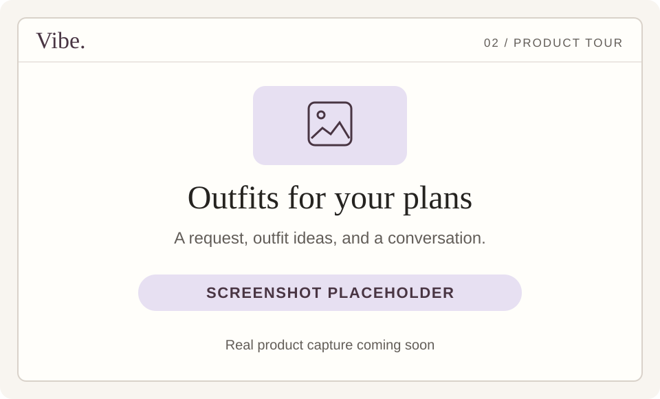

[← Vibe home](../README.md) · [Use Vibe ↗](https://vibe-consumer-web.vercel.app/) · [Get started](GETTING_STARTED.md)

# Follow the Vibe walkthrough


**Video recording coming soon.** This is the reserved place for a captioned product walkthrough. Until the recording is available, follow this tour in the [live app](https://vibe-consumer-web.vercel.app/).

## 1 · Start with your plans

After sign-in and profile analysis, describe an occasion and budget:

```text
Find me a relaxed dinner outfit under ₹8,000.
I like black and earth tones, and I want something less formal.
```

Use your actual preferences and the currency for your shopping market.

## 2 · Explore the suggestions

Browse the outfit carousel. Read the explanation and inspect the individual garments, retailer names, available price information, and product details.



## 3 · Change the direction

Choose a specific outfit and ask for a precise change:

```text
In outfit 2, keep the shirt and change the trousers.
Keep the look within my original budget.
```

The walkthrough will show the actual response and any limitation the app reports. It will not substitute a scripted result for an observed turn.

## 4 · Picture a look

Use **Virtual try-on** on an eligible card. Inspect the generated preview and save a look you like.


## 5 · Keep it, share it, or inspect the retailer

Revisit a saved look in **Looks**. After a try-on is available, use **Share look** if you want to share it. Open an individual product’s retailer action when you want to inspect its offer.

[Open Looks ↗](https://vibe-consumer-web.vercel.app/looks.html) · [Open Vibe Chat ↗](https://vibe-consumer-web.vercel.app/)

---

For replacing these placeholders with real captures, see the [media checklist](MEDIA.md). The live app remains the place to try the product; this guide does not run recommendations inside GitHub.
