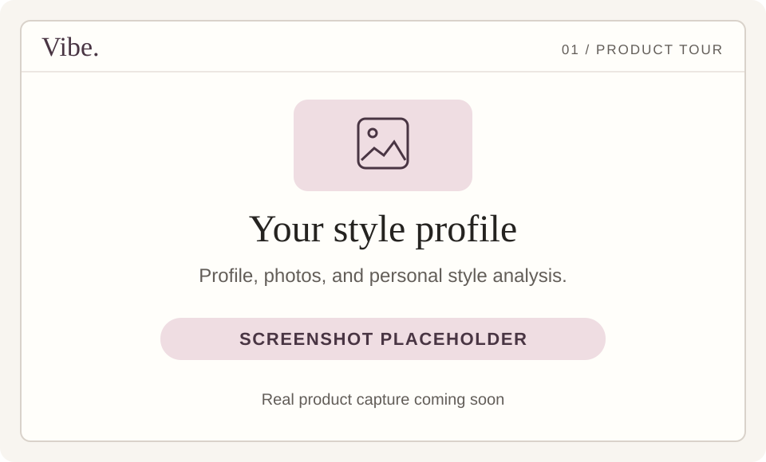
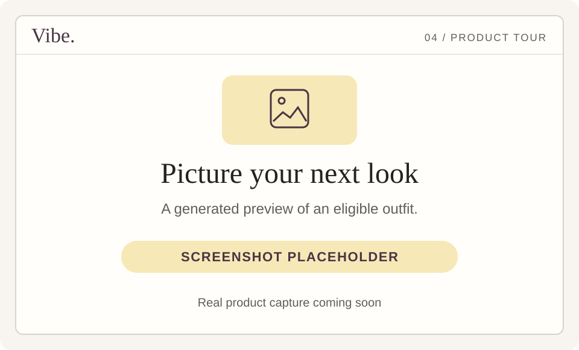

[← Vibe home](../README.md) · [Get started](GETTING_STARTED.md) · [Try a prompt](TRY_VIBE.md) · [FAQ](FAQ.md)

# The Vibe feature guide

Use this page to find a feature, understand the interaction, and open the right place in the app. Account features require sign-in and the relevant onboarding steps.

## Conversational styling

**Where:** [Chat ↗](https://vibe-consumer-web.vercel.app/)

Describe an occasion, ask for a specific clothing piece, add a budget, or explain a color or style preference. Outfit cards group the recommended pieces, and the carousel lets you move between looks. Follow-up messages can ask for another direction or a change to a named look.

You can also ask for style advice and explanations. State “no products” if you want advice without a shopping result. [Copy a starting prompt →](TRY_VIBE.md)

## Profile and personalization

**Where:** [Profile ↗](https://vibe-consumer-web.vercel.app/profile.html)

Review your saved profile details, measurements, photographs, and style-analysis results. Edit details, select the IND or USA measurement preset, replace a photo, and refresh the analysis after changes. Recommendations require completed profile inputs and successful current photo analysis.

The shopping market is detected from network location; switching a measurement preset does not change your shopping country.

## Wardrobe and garment photos

**Where:** [Wardrobe ↗](https://vibe-consumer-web.vercel.app/wardrobe.html) and the attachment control in [Chat ↗](https://vibe-consumer-web.vercel.app/)

Add a garment photo and choose its category to store an owned item. View those items in your wardrobe. For a styling request, attach a garment photo or select an existing wardrobe item, and explain what you already own and what you want to add.

The current guide focuses on a clear owned-garment starting point. Broader combinations of multiple photos and saved items are being developed and verified. [See the roadmap →](ROADMAP.md)

## Product details and retailer links

**Where:** open a garment inside an outfit card in [Chat](https://vibe-consumer-web.vercel.app/) or [Looks](https://vibe-consumer-web.vercel.app/looks.html).

Inspect garment images, the product description, retailer, displayed price, and available evidence indicators. Outfit overviews include the relevant explanation and look total. When the app shows a listed-price total or missing verification, use that context when comparing options.

The product action opens the independent retailer’s site. Vibe does not run the checkout. Confirm current stock, selected size, price, delivery details, and returns with that retailer.

## Virtual try-on

**Where:** an eligible outfit card’s **Virtual try-on** action; generated previews are also accessible in [Looks ↗](https://vibe-consumer-web.vercel.app/looks.html).

Use the action to generate a visual preview from your saved photo and the available garment images. The action depends on feature availability and usable images. Look history has a “Virtual try-ons only” filter.

The output is AI-generated styling visualization. It does not establish physical fit, exact color, or the construction of the real garment.

## Looks history, saves, and wishlisting

**Where:** [Looks ↗](https://vibe-consumer-web.vercel.app/looks.html)

Revisit recommendation history and filter by theme, saved looks, or virtual try-ons. Use **Save this look** on an outfit you want to return to. Use the individual product wishlist action to shortlist a piece. Use the card’s remove action when you want to remove a look from the collection.

There is no separate wishlist destination linked from this guide; the product-level wishlist action is available inside the card.

## Sharing

**Where:** **Share look** after a generated try-on is available.

Use your browser’s native share sheet where supported, or copy the generated share link. The recipient opens a shared-look page. The share includes the selected look and any shared visualization; review what you are sharing before sending it.

This guide does not create or publish a share link on your behalf.

## Retailer directory

**Where:** [Retailers ↗](https://vibe-consumer-web.vercel.app/retailers.html)

Browse the directory and its store statuses. Suggest a retailer by submitting its domain. The app checks compatibility and eligible product coverage before a store becomes active. Status and coverage can change over time, and the directory is specific to the supported shopping market.

## Feature requests and voting

**Where:** [Feature board ↗](https://vibe-consumer-web.vercel.app/feature-requests.html)

Browse requests, choose “Most upvoted” or “Newest”, submit one specific idea per request, and vote for requests you want to use. Your idea and vote count are visible to signed-in members; your phone number is not displayed to them.

## Data controls and support

**Where:** the app’s profile menu → **Help & Privacy**; [Support ↗](https://vibe-consumer-web.vercel.app/support.html); [Privacy ↗](https://vibe-consumer-web.vercel.app/privacy.html).

Read the current privacy notice, obtain a copy of your data, correct profile information, withdraw styling consent, sign out, or choose account-data deletion using the available app controls. Signing out and deleting your data are different actions.

For a retailer problem, report the affected product and retailer domain through Support. Never post sign-in codes, photographs, or private account information in a public GitHub issue.

## What is still being built?

See the [roadmap](ROADMAP.md) for multi-day capsule planning and broader query improvements. A proposed feature or local implementation check is not presented here as a completed customer journey.
